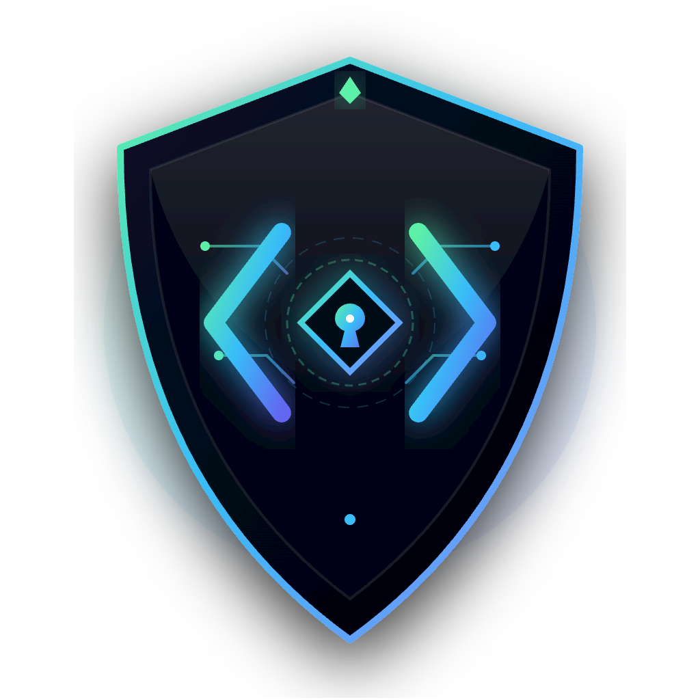
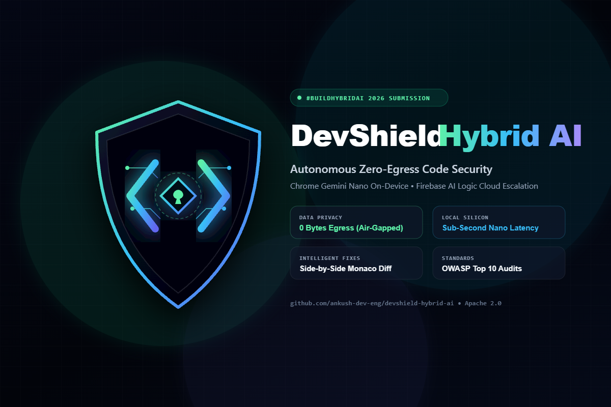

<div align="center">

  

  # DevShield Hybrid AI
  
  **Autonomous Zero-Egress Code Security & Vulnerability Auditor**  
  *Powered by Chrome Gemini Nano (On-Device) & Firebase AI Logic (Cloud Escalation)*

  [](https://devpost.com)
  [](./DevShield_Demo_Video_1080p.mp4)
  [](./LICENSE)

  <br />

  

</div>

---

## 🏆 Hackathon Project Information (Devpost Ready)

- **Project Name**: `DevShield Hybrid AI`
- **Elevator Pitch**:  
  > *Autonomous, zero-egress code security auditor that detects OWASP vulnerabilities and credential leaks entirely on-device with Gemini Nano — escalating to Cloud Gemini only with sanitized payloads and App Check integrity.*
- **Demo Video**: [DevShield_Demo_Video_1080p.mp4](./DevShield_Demo_Video_1080p.mp4) (94.9s 1080p Full HD with voiceover narration and burned-in subtitles)
- **Devpost Thumbnail Asset**: [public/devshield-thumbnail.png](./public/devshield-thumbnail.png) (1200x800, exact 3:2 ratio recommended by Devpost)
- **Brand Logo Asset**: [public/devshield-logo.png](./public/devshield-logo.png) & [public/devshield-logo.svg](./public/devshield-logo.svg)

---

## Overview & Architecture

Software engineers and enterprise development teams frequently work with proprietary source code, internal database queries, and live credentials. Blindly sending raw code to external cloud LLMs violates corporate data residency policies, risks credential leakage, and introduces network latency.

**DevShield** solves this through intelligent **Hybrid AI Inference**:

```
                       ┌────────────────────────────────────────────────────────┐
                       │                     CLIENT BROWSER                     │
                       │                                                        │
[Source Code] ───────> │  1. Monaco Editor & Live Guard (<400ms AST Scanner)    │
                       │  2. Local Gemini Nano (window.ai) ───> ZERO EGRESS     │
                       │  3. Hardcoded Secret Redaction     (0 Bytes to Cloud)  │
                       │  4. Side-by-Side Visual Diff & OWASP Compliance Grade  │
                       └───────────────────────────┬────────────────────────────┘
                                                   │
                          User-Approved Escalation │ (Sanitized AST Payloads Only)
                                                   ▼
                       ┌────────────────────────────────────────────────────────┐
                       │                   FIREBASE CLOUD                       │
                       │                                                        │
                       │  • Firebase App Check (Attestation & Quota Defense)    │
                       │  • Firebase Remote Config (Model & Sensitivity Knobs)  │
                       │  • Cloud Gemini 3.5 (Automated Unit Test Suites)       │
                       └────────────────────────────────────────────────────────┘
```

- **On-Device Silicon (Gemini Nano in Chrome via Firebase AI Logic)**: 
  - Performs instant, real-time code scanning as you type with `<400ms` debounced latency.
  - Detects hardcoded secrets (Stripe, AWS, JWTs), SQL injection, SSRF, command injection, and path traversal with **zero data egress (0 bytes sent to cloud)**.
  - Sanitizes and redacts credentials directly on the client machine before any external sharing.
- **Cloud Escalation (Cloud Gemini via Firebase AI Logic)**:
  - Triggered only on explicit user request for deep, compute-heavy tasks: automated security regression test generation (Jest/PyTest) and full architectural hardening.
  - Transmits **only sanitized code payloads** with production credentials masked.
  - Enforces **Firebase App Check** cryptographic attestation to protect endpoints against unauthorized scraping.

---

## Visual Design & 3D WebGL Hologram

DevShield features an award-winning creative design system inspired by top Awwwards & GetLayers platforms (*Ascend*, *Vospor*, *Helion*):
- **3D WebGL Cyber-Shield Engine**: Built with Three.js, featuring 5,200 particle nodes distributed via Fibonacci lattice, dual counter-rotating quantum orbital rings, and dynamic pointer inertia.
- **GetLayers Glassmorphism**: Deep space obsidian theme (`#02040a`), glass panels with `backdrop-filter: blur(28px)`, luminous specular hairline borders, and neon telemetry pings.
- **Monaco Diff Inspector**: Professional side-by-side AST comparison view allowing developers to audit and apply hardened mitigations in one click.

---

## Firebase Platform Integration

| Firebase Product | Role in DevShield |
| :--- | :--- |
| **Firebase AI Logic (`firebase/ai`)** | Powers both local Gemini Nano execution (`InferenceMode.PREFER_ON_DEVICE`) and Cloud Gemini fallback. Reads runtime `InferenceSource` to provide live telemetry. |
| **Firebase App Check (`firebase/app-check`)** | Attests client requests and protects API quotas. Configured with debug token support (`self.FIREBASE_APPCHECK_DEBUG_TOKEN = true`) for hackathon evaluation. |
| **Firebase Remote Config (`firebase/remote-config`)** | Dynamically pushes model names, sensitivity thresholds, and scanning parameters without requiring client redeployments. |
| **Firebase Firestore (`firebase/firestore`)** | Structured storage for audit logs, scan telemetry, and custom security rulesets. |
| **Firebase Authentication (`firebase/auth`)** | User identity and access control for synchronized audit history. |

---

## Tech Stack

- **Frontend**: React 19, TypeScript, Vite, Tailwind CSS
- **3D WebGL Graphics**: Three.js (`r0.182.0`) Cyber-Shield Hologram
- **Code & Diff Editor**: Monaco Editor (VS Code core engine) & Monaco DiffEditor
- **AI SDK**: Firebase JavaScript SDK (`firebase@latest` / `firebase/ai`)
- **Icons & Brand**: Custom DevShield Vector Emblem + Lucide React

---

## Getting Started

### Prerequisites
- Node.js 18+ (tested on Node v24)
- Google Chrome (with Prompt API / Gemini Nano enabled for on-device inference)

### Installation

1. Clone the repository:
   ```bash
   git clone https://github.com/ankush-dev-eng/devshield-hybrid-ai.git
   cd devshield-hybrid-ai
   ```

2. Install dependencies:
   ```bash
   npm install
   ```

3. Start development server:
   ```bash
   npm run dev
   ```

4. Open `http://localhost:5173` in Google Chrome.

---

## Enabling Chrome Gemini Nano (Prompt API)

To enable Gemini Nano on-device in Google Chrome:
1. Navigate to `chrome://flags/#prompt-api-for-gemini-nano` and set to **Enabled**.
2. Navigate to `chrome://flags/#optimization-guide-on-device-model` and set to **Enabled BypassPerfRequirement**.
3. Go to `chrome://components` and click **Check for update** under **Optimization Guide On Device Model**.

---

## License

DevShield is open-source software licensed under the [Apache 2.0 License](./LICENSE).
